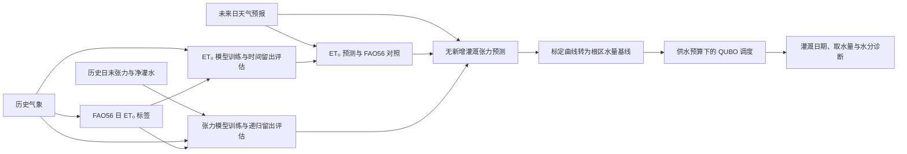

# ET₀、土壤水分预测与灌溉调度

预测模式先利用历史数据评估并训练模型，再把未来 ET₀ 和土壤水分状态转换成现有调度模型的输入。天气预报来自输入文件；调度结果可由经典精确求解、贪心或 QAOA 生成。项目始终保留直接提供 `et0_mm` 的使用方式。



## 预测模块与实现范围

预测模块将气象输入、FAO56 ET₀ 标签和滞后土壤水分张力连接起来，生成日尺度的小麦灌溉调度输入。辐射接口采用用户预先计算的日净辐射，土壤张力通过逐地块标定曲线换算为根区可利用水量。

| 维度           | 项目实现                                                                         |
| -------------- | -------------------------------------------------------------------------------- |
| 应用对象       | 三个关中冬小麦合成场景，或用户自有田块数据                                       |
| 时间尺度       | 日 ET₀、日末张力和逐日灌溉决策                                                   |
| ET₀ 标签与对照 | 内置 FAO56 日计算值；未来保留同天气下的 FAO56 对照                               |
| 预测输入       | 目标日天气预报驱动 ET₀；张力还使用过去张力和净灌水                               |
| 模型           | NumPy 岭回归基线和 4 比特可训练 VQC 小模型                                       |
| 量子实现       | VQC 预测使用 NumPy CPU 态矢量模拟；调度 QAOA 默认调用 pyqpanda_alg，后端分别选择 |
| 时间评估       | 默认按时间留出后约 20% 的可用样本，完成评估后以全部历史重新训练                  |
| 调度连接       | 将预测变成固定无新增灌溉水量基线，再优化二进制灌溉日程                           |

模型精度由输入数据上的时间留出评估给出，训练状态和计算配置随结果导出。内置合成数据用于验证流程，不=替代实际田间数据的标定与评估。

## 运行和复现

按 [README](../README.md#安装与运行) 安装后，从当前 `wheat_irrigation/` 项目目录运行：

```bash
python irrigation.py --forecast-demo --backend classical --no-plot --output outputs/forecast_demo
python irrigation.py --scenario grain_filling --forecast-demo --forecast-model vqc --forecast-maxiter 30 --backend classical --output outputs/grain_forecast_vqc
python irrigation.py --input my_field.json --forecast-input my_forecast.json --output outputs/my_forecast
```

`--forecast-demo` 与 `--forecast-input` 互斥。演示数据与所选的 `jointing`、`heading` 或 `grain_filling` 场景对应，每次生成 84 天历史和完整规划期天气；各场景仍是独立的一周，不会自动拼接为一个生长季。`--forecast-model ridge|vqc` 默认 `ridge`；`--forecast-maxiter` 默认 30，用于 VQC 训练，与调度的 `--maxiter` 分别配置。随机种子使用 `--seed`，默认 7。调度默认采用 `--backend pyqpanda_alg`，依赖算法包和 `pyqpanda3`；示例中的 `--backend classical` 可只安装基础依赖，`--backend numpy` 则显式使用 NumPy QAOA。

预测模式输出 `resolved_input.json`，包含这次实际采用的 ET₀、降雨、初始根区水量和每日水量调整项。直接把它作为调度输入可固定预测结果，并单独改变调度算法：

```bash
python irrigation.py --input outputs/forecast_demo/resolved_input.json --backend classical --no-plot --output outputs/replay
python irrigation.py --forecast-demo --export-input resolved_field.json --backend classical --no-plot
```

第二条命令的 `--export-input` 也导出解析后的调度输入。复跑时省略预测选项即可避免重新训练；原始预测请求保存在 `forecast_input.json` 和 `summary.json` 的 `forecast_input` 中，用于检查数据来源和重新运行预测。预测前的调度配置另存于 `summary.json` 的 `scheduling_input_before_forecast`。

## 自有预测数据格式

`--input` 提供地块、TAW、Kc、灌溉窗口和供水预算等调度参数；`--forecast-input` 提供气象与张力序列，两个 JSON 分工不同。最直接的完整模板是演示运行导出的 `forecast_input.json`：

启用预测时，调度输入可以省略将被覆盖的 `et0_mm`、`rainfall_mm`、`initial_moisture_mm`；初始水量由最后一天历史张力换算。其他调度参数仍须满足原有校验。未启用预测的普通 `--input` 仍要求这三个字段完整。

```bash
cp outputs/forecast_demo/forecast_input.json my_forecast.json
cp outputs/forecast_demo/resolved_input.json my_field.json
python irrigation.py --input my_field.json --forecast-input my_forecast.json --backend classical --no-plot --output outputs/my_data
```

复制后的数据仍是合成示例；修改数据时同时更新 `source_note`、日期、地块名和标定曲线。所有数值必须有限，拒绝 NaN/Infinity；程序不自动填补缺失观测或重采样。

| 预测 JSON 顶层字段 | 规则                                                                          |
| ------------------ | ----------------------------------------------------------------------------- |
| `frequency`        | 必须为`"daily"`                                                               |
| `source_note`      | 必填非空字符串，描述数据提供者、合成/实测/预报属性及处理过程                  |
| `lookback_days`    | 正整数，默认 3，ET₀ 和张力共用此滞后长度                                      |
| `holdout_fraction` | `(0, 0.5]`，默认 0.2                                                          |
| `weather_history`  | 逐日天气对象数组，日期连续、严格递增，最后一天必须是调度`start_date` 的前一天 |
| `weather_forecast` | 同一结构的逐日天气预报数组，必须从`start_date` 开始，恰好覆盖调度的 `days` 天 |
| `zones`            | 逐地块观测和标定对象，地块名称集合须与调度输入完全相同，无重复                |

所有地块共享这里的天气序列；张力模型和标定曲线各地块独立。需要分地块天气时，应扩展输入与训练接口，不能在同一共享序列中混排不同站点的日期。

| 每个天气对象的字段                                       | 单位与规则                                                     |
| -------------------------------------------------------- | -------------------------------------------------------------- |
| `date`                                                   | `YYYY-MM-DD`                                                   |
| `tmin_c`, `tmax_c`                                       | °C，`−80 ≤ tmin ≤ tmax ≤ 60`                                   |
| `relative_humidity_min_pct`, `relative_humidity_max_pct` | %，`0 ≤ RHmin ≤ RHmax ≤ 100`                                   |
| `wind_speed_2m_m_s`                                      | m/s，非负，已换算到 2 m 高度                                   |
| `net_radiation_mj_m2_day`                                | MJ/m²/天，地表日净辐射，可为负；不能直接填写太阳入射短波辐射   |
| `rainfall_mm`                                            | mm/天，非负日总降水，必填；它是土壤特征，不进入 FAO56 ET₀ 公式 |
| `atmospheric_pressure_kpa`                               | 可选，默认 101.3 kPa，必须为正；应提供所在地气压               |
| `soil_heat_flux_mj_m2_day`                               | 可选，默认 0，MJ/m²/天，可为负                                 |

例如一条天气记录：

```json
{
  "date": "2026-03-20",
  "tmin_c": 7.5,
  "tmax_c": 21.0,
  "relative_humidity_min_pct": 35.0,
  "relative_humidity_max_pct": 80.0,
  "wind_speed_2m_m_s": 1.7,
  "net_radiation_mj_m2_day": 10.0,
  "rainfall_mm": 0.0,
  "atmospheric_pressure_kpa": 96.0,
  "soil_heat_flux_mj_m2_day": 0.0
}
```

`zones` 中每个对象包含 `name`、`history`、`retention_curve`。`history` 的日期必须与 `weather_history` 逐日完全一致，每条记录包含 `date`、非负 `tension_kpa` 和非负 `net_irrigation_mm`；净灌水是实际到达根区的水深，不是渠首毛取水。即使没有灌水，也必须明确写 `0`。未来灌溉由调度决定，预测模块固定使用 0，不读取未来实测张力或预定灌水记录。

以下是 `taw_mm=120` 地块的**演示**标定表片段：

```json
{
  "tension_kpa": [0, 10, 30, 60, 1500],
  "available_water_mm": [120, 102, 72, 42, 0]
}
```

两个数组长度相同且至少有两个点，张力非负且严格递增，水量严格递减，首项必须等于该地块 `taw_mm`，末项必须为 0。所有历史张力必须位于曲线标定范围内，超范围会报错，转换函数不外推。

设历史长度为 `N`、滞后天数为 `L`，留出样本数为 `H=max(2, ceil((N−L)×holdout_fraction))`。训练目标有 `N−L−H` 个，至少需要 8 个。因此默认 `L=3`、比例 0.2 时，至少需要 13 天完整历史；这只是程序运行下限，不代表足以建立可靠的田间预测模型。默认合成示例的 84 天产生 64 个训练样本、17 个留出样本，最终重新训练使用 81 个目标样本。

## 日 ET₀ 计算和预测

历史 ET₀ 标签由完整日气象字段计算，使用草地参考面的 FAO56 Penman–Monteith 公式：

```text
ET0 = [0.408×Δ×(Rn − Gsoil) + γ×900/(Tmean+273)×u2×(es−ea)]
      / [Δ + γ×(1 + 0.34×u2)]
```

土壤热通量默认 `Gsoil=0`，也可显式提供。它与调度水量平衡中的毛管上升 `G` 单位和含义不同。日净辐射由用户提供，风速须已换算至 2 m；当前接口不从太阳入射辐射计算净辐射，也不根据纬度、海拔和日期估算辐射或气压。算法依据见 [FAO56 第 2 章](https://www.fao.org/4/x0490e/x0490e06.htm) 和[第 3 章](https://www.fao.org/4/x0490e/x0490e07.htm)。

ET₀ 学习模型拟合“目标日天气与过去 ET₀ → FAO56 ET₀”的映射，使用 9 项天气特征和 `lookback_days` 个 ET₀ 滞后值。规划期输入未来天气预报，递归使用前面预测的 ET₀，输出供调度使用的 ET₀。同时计算相同预报天气的 FAO56 ET₀，作为可以检查的物理公式对照。该对照不参与未来标签训练，也不是未来观测真值。历史标签由程序计算，不接受用户直接指定的 ET₀ 观测标签。

负的 FAO56 计算结果按 0 蒸散需求处理；学习模型的负 ET₀ 也裁剪为 0，裁剪前后预测均保存。这不把负蒸散作为凝结补水计入调度。

历史留出期可用天气通常是观测天气。因此留出分数主要衡量模型近似 FAO56 映射的误差，不包含未来天气预报本身的误差。实际预测的可用信息以发布时点为准，而不是把事后观测天气混入真实业务的未来天气输入。

## 日末土壤张力和水量基线

土壤模型的目标是土壤水分张力 `ψ`，单位 kPa，使用正值吸力约定：数值越大通常越干。历史输入中的张力是各日**日末**状态，当日净灌水属于从前一日日末到当日日末的水量输入。模型利用滞后张力、气象、ET₀、降雨和历史净灌水学习干湿变化。小时或多深度传感器记录应先由数据提供方按一致的根区代表性规则聚合为日末值，保留聚合方法；程序不自动假设传感器深度权重。

规划期递归预测时，新增灌溉固定为 0。第一天使用规划前已有的历史张力；随后将前一天预测张力加入滞后窗口。这样得到的是“在当前天气预报下，不执行新的灌溉”的状态基线，调度决策尚未参与张力预测。

每个地块必须提供本地标定的 `retention_curve`：`tension_kpa` 严格递增，`available_water_mm` 严格递减，水量首尾为 TAW 和 0。利用分段线性插值把张力转换成根区植物可利用水量。这种水量以永久萎蔫点为 0、田间持水量为 TAW；它不是体积含水率，也不是土壤总含水量。

模型预测的原始张力可能超出标定范围，显式裁剪到曲线端点再递归及换算，输出原始值、裁剪值和标记。历史观测越界则直接拒绝。张力范围裁剪发生在预测阶段，调度叠加灌水后的水量不会裁剪。

令换算后的无新增灌溉水量为 `B[z,d]`，规划前最后一个历史状态为 `B[z,0]`。调度实际采用：

```text
A[z,d] = B[z,d] − B[z,d−1]
         − (Peff[z,d] + capillary_rise[z,d] − Kc[z,d]×ET0_hat[z,d])
M[z,d] = M[z,d−1] + dose×x[z,d] + Peff + capillary_rise − Kc×ET0_hat + A
       = B[z,d] + dose×Σ[t≤d]x[z,t]
```

`A` 存在地块字段 `forecast_adjustment_mm` 中。它是可正可负的差值调整，不是新预测的降水或毛管补水，也不计入灌溉预算。它让学习基线替换原有无灌溉轨迹，并避免把基线已经反映的 ET₀、雨量再次累计。由于每次求解时 `B` 固定，水量仍是二进制决策的仿射函数，原有平方目标仍能准确展开为 QUBO，见 [model.md](model.md)。

这一替换有明确的参数边界：重新预测时，单独改变未来 `crop_coefficient`、`capillary_rise_mm` 或 `effective_rain_fraction` 会被重新计算的 `A` 抵消，不会独立改变 `B` 或日程；预测模式中的 ETc 是参考需求项。ET₀ 与雨量通过张力模型的输入影响水分基线，TAW、标定表、目标、权重、窗口和预算仍影响调度。需要研究作物系数变化的物理效应时，应使用没有预测调整项的直接水量平衡模式，或扩展土壤预测模型的历史特征与结构。

这里假设灌水效果可以在固定基线上线性累加。它不模拟每种候选日程引发的张力反馈、非线性下渗、径流或胁迫蒸散变化，也不自动将灌溉后的水量裁剪到 TAW。因此预算可行的日程仍可能出现过湿或不足，需查看 `moisture.csv` 和报告诊断。要滚动运行，下一日应加入实际张力与已执行净灌水、更新天气预报及剩余供水预算，再调用同一流程；当前 CLI 不自动连接传感器或执行灌溉。

## 训练、评估和输出解释

训练样本按日期顺序划分，默认后约 20% 留出用于评估，取整与最低样本数规则见上文。特征与目标采用 Min-Max 缩放，参数仅在前段训练样本上拟合；恒定列的缩放分母取 1，留出或未来数据超出训练范围时不裁剪缩放值。ET₀ 和张力留出预测均递归使用自己的过去预测，不把留出期真实目标重新喂回模型；张力留出模型使用 ET₀ 的留出预测，以及该期记录的天气和净灌水。评估完成后，使用全部历史重新拟合缩放和模型，再生成未来规划预测。

`ridge` 用 NumPy 求解带 L2 正则的线性回归，默认 `alpha=0.01`，截距不惩罚。`vqc` 先把缩放特征通过固定种子的高斯投影压到 4 维，进行 RY 角度编码、逐比特 RX/RY/RZ 旋转和环形 CNOT，再读取 4 个 Pauli-Z 期望。电路角度由 SciPy L-BFGS-B 配合参数移位梯度训练；每个候选电路的线性读出由岭回归求解。它训练电路参数，单次训练达到 `--forecast-maxiter` 上限时保留已评估的最佳参数，并在模型描述中保留停止状态，不把到达上限当作收敛，它不是固定随机电路特征。

每个目标同时报告 `persistence_holdout_metrics`：将训练边界前最后一个已知目标保持不变，贯穿整个留出期的持续性基线。这是与递归预测相同起点的多步基线；不是每天利用新的真实目标更新的一步预测。默认 ridge 无须 SciPy；VQC 需要项目现有的 SciPy 依赖。

| 指标 | 含义                                                                             |
| ---- | -------------------------------------------------------------------------------- |
| MAE  | 平均绝对误差，越小越好；ET₀ 为 mm/天，张力为 kPa                                 |
| RMSE | 均方根误差，对较大的误差更敏感，单位同目标                                       |
| NSE  | `1 − Σ(y−ŷ)² / Σ(y−mean(y))²`，1 最好，0 对应观测均值基线                        |
| KGE  | `1 − sqrt((r−1)² + (σŷ/σy−1)² + (mean(ŷ)/mean(y)−1)²)`，1 最好；0 不代表均值基线 |

恒定观测使 NSE 未定义；恒定观测、恒定预测或观测均值为零使 KGE 未定义，此时对应字段导出 `null`。

启用预测后，报告除原有调度对照外还提供以下内容。使用 `--no-plot` 时仍保存预测数据和文本报告。

| 文件或字段                                                          | 内容                                                                               |
| ------------------------------------------------------------------- | ---------------------------------------------------------------------------------- |
| `forecast_input.json`                                               | 完整原始预测输入，适合作为自有数据模板                                             |
| `forecast.json` 的 `evaluation`                                     | 训练/留出日期和样本数、最终重训截止时间及评估条件                                  |
| `forecast.json` 的 `et0` 和 `soil.<地块名>`                         | 留出真值、预测、误差指标、持续性对照、缩放参数与训练后模型描述                     |
| `forecast.json` 的 `et0.predicted_mm` / `fao56_weather_forecast_mm` | 未来 ET₀ 学习预测和相同天气下的 FAO56 对照                                         |
| `forecast.json` 的 `soil.<地块名>.clipped_days`                     | 未来原始张力超出标定范围而被裁剪的规划日，日期编号从 1 开始                        |
| `forecast.csv`                                                      | 每地块每日 ET₀、FAO56 对照、ETc、雨量、原始/采用张力、裁剪标记、无灌溉水量与调整项 |
| `forecast.png` / `forecast.svg`                                     | ET₀ 和逐地块张力的留出与未来轨迹，虚线标记重新训练后的规划边界                     |
| `resolved_input.json`                                               | 含预测 ET₀、雨量、最新观测初始水量和调整项的可复跑调度输入                         |

`forecast.csv` 的 `forecast_net_irrigation_mm` 恒为 0，标明预测基线的条件；最终灌溉方案在 `schedules.csv` 中。先检查 ET₀ 与 FAO56 对照、张力裁剪和无灌溉水量，再查看各方案的 `moisture.csv`，可以区分预测问题与调度选择。
